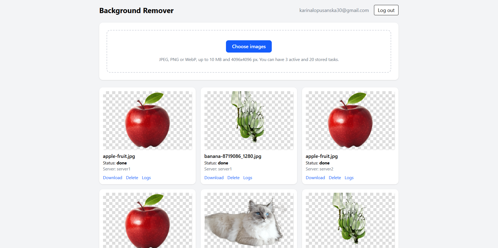
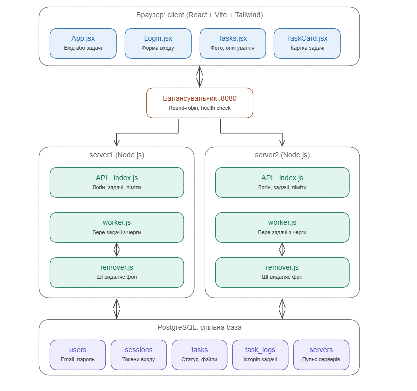
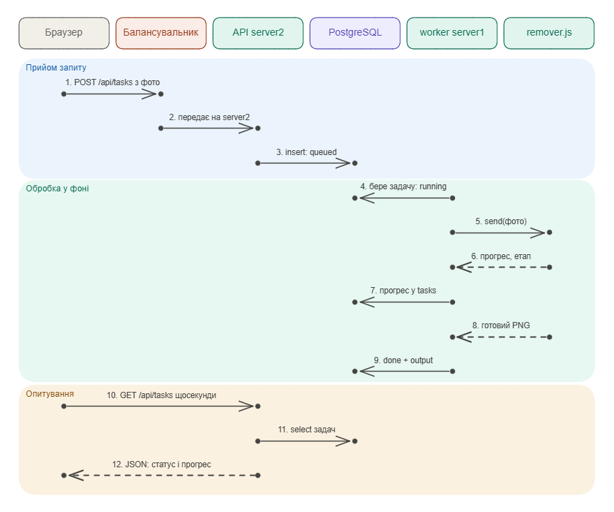
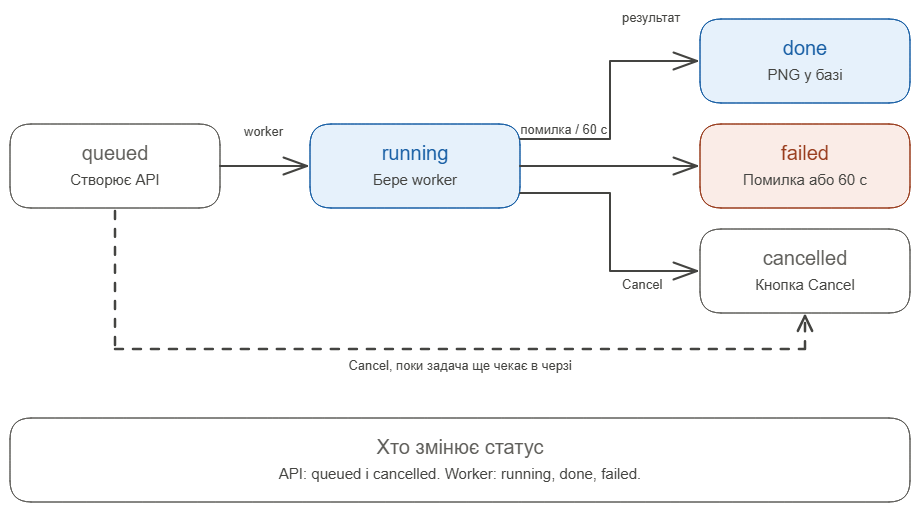
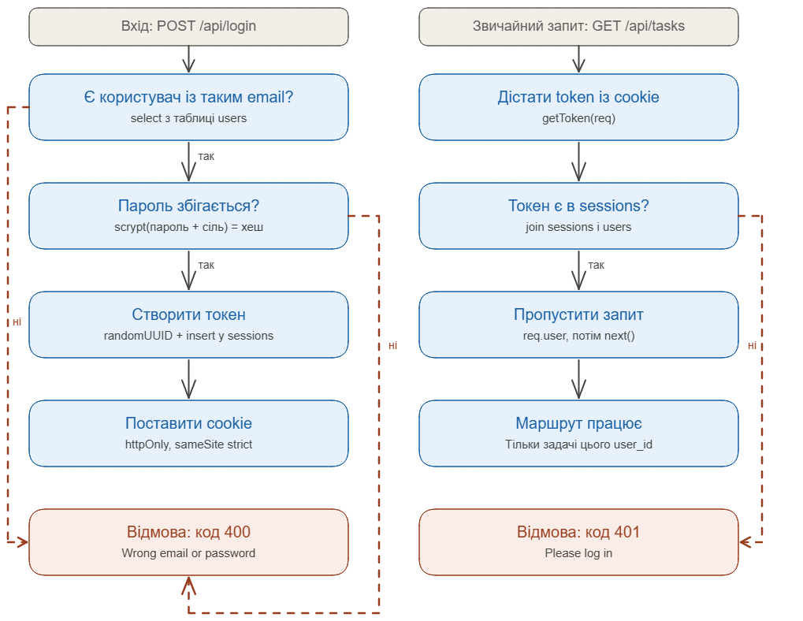
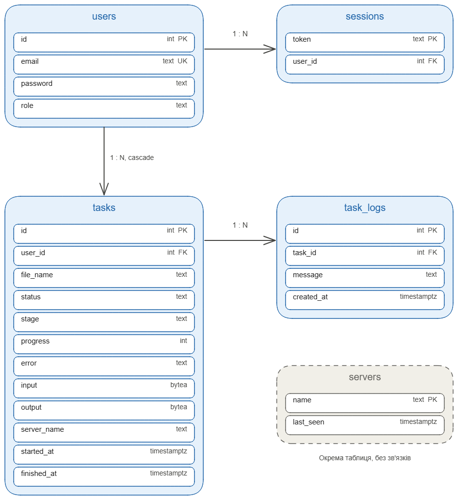

# Background Remover

Веб-застосунок, який прибирає фон із фотографій. Це лабораторна з веб-розробки: сервер має нормально обробляти "важкі" запити, тому все, що довго рахується, іде у фоні, з чергою, прогресом і кількома серверами. Сам фон видаляє бібліотека [@imgly/background-removal-node](https://www.npmjs.com/package/@imgly/background-removal-node).

Завантажуєш одне чи кілька фото, вони стають у чергу. На кожній картці видно статус, прогрес і на якому сервері це обробляється. Коли готово, результат можна відкрити, скачати як PNG або видалити.

## З чого складається

- `client` - React + Vite + Tailwind
- `server` - Node.js + Express, запускається у двох копіях (`server1` і `server2`)
- `balancer` - власний балансувальник на чистому Node.js, без nginx
- PostgreSQL - зберігає все: користувачів, сесії, задачі і самі картинки (і оригінал, і результат)

Браузер звертається тільки до балансувальника (порт 8080), а той по черзі передає запити на `server1` і `server2`. Сервери однакові й самі нічого не запам'ятовують, усе лежить у базі. Тому не важливо, який із них відповість.

## Обмеження

- тільки JPEG, PNG або WebP
- файл до 10 МБ
- зображення до 4096x4096 px
- обробка не довше 60 секунд
- не більше 3 активних задач на користувача
- не більше 20 збережених задач на користувача

Усе це перевіряється на сервері. Клієнт перевіряє тільки тип і розмір файлу, щоб не відправляти зайвого.

## Як проходить одна задача

Якщо коротко:

1. Фото зберігається в таблицю `tasks` зі статусом `queued`.
2. Worker на одному із серверів бере найстарішу задачу і запускає видалення фону в окремому процесі. Окремий процес потрібен, щоб його можна було вбити, якщо задачу скасували або вона працює надто довго.
3. Процес шле етап і відсоток, worker пише їх у базу і в `task_logs`.
4. Браузер раз на секунду питає список задач і малює прогрес.
5. Кожну секунду worker дивиться, чи задачу не скасували або не видалили. Якщо так, процес вбивається. Через 60 секунд він вбивається в будь-якому разі.
6. Готовий PNG записується в базу.

Статуси задачі такі:

## Авторизація

Паролі зберігаються як хеш `scrypt` із сіллю. Після входу сервер створює токен, пише його в таблицю `sessions` і ставить cookie (`httpOnly`, `sameSite: strict`). На кожному запиті токен перевіряється в базі. Токени лежать у базі, а не в пам'яті сервера, тому з двома серверами це працює без додаткових налаштувань. Користувач бачить тільки свої задачі.

## База даних

Таблиця `servers` стоїть окремо, вона потрібна лише для підрахунку живих серверів. Якщо видалити користувача, зникають його сесії й задачі, а разом із задачею її логи.
